# Hi, I'm Sendo 👋

## About

iOS Software Engineer at **Grab**, based in Jakarta. I build user-facing features for the **Grab Driver** app, used by millions across Southeast Asia. Before that, I shipped the **TikTok Seller Center** and **Tokopedia** iOS apps at ByteDance. I focus on clean mobile architecture, legacy codebase modernization, and AI-accelerated engineering workflows.

---

### 🔭 Currently Exploring
- 🚗 **Driver Workflows & Infra**: In-Transit driver experience and mobile infrastructure at **Grab**.
- 🧠 **Modern iOS & Concurrency**: Swift 6 strict concurrency, WidgetKit & Live Activities.
- 🤖 **Agentic Engineering**: AI harness development, agentic workflows, and LLM-assisted mobile engineering.
- 💬 **Ask Me About**: The Composable Architecture (TCA), Server-Driven UI (SDUI), and scaling consumer iOS apps.

---

## Products Shipped & Impact

<table>
  <tr>
    <td width="50%">
      <h3>🚗 Grab Driver iOS</h3>
      
<b>Grab</b> · <i>Nov 2025 – Present</i>

      <ul>
        <li>Owned and iterated the <b>In-Transit flow</b> (from job acceptance to drop-off completion) for millions of drivers across Southeast Asia.</li>
        <li>Collaborated on building Grab's internal <b>AI Harness Engineering plugin</b> and knowledge base to accelerate mobile engineering velocity.</li>
      </ul>
      
<code>Swift</code> <code>TCA</code> <code>Clean Architecture</code>

    </td>
    <td width="50%">
      <h3>🛍️ TikTok Seller Center & Tokopedia</h3>
      
<b>ByteDance (Tokopedia)</b> · <i>Oct 2023 – Nov 2025</i>

      <ul>
        <li>Integrated <b>TikTok Open Auth SDK</b> for buyer/seller account binding during Tokopedia & TikTok Shop integration.</li>
        <li>Architected <b>Server-Driven UI (SDUI)</b> for account modules enabling rapid A/B testing; migrated legacy Texture UI to modern UIKit & SwiftUI.</li>
      </ul>
      
<code>SwiftUI</code> <code>UIKit</code> <code>Server-Driven UI</code> <code>SDK Integration</code>

    </td>
  </tr>
  <tr>
    <td width="50%">
      <h3>💳 OVO App</h3>
      
<b>Grab (OVO)</b> · <i>Sep 2022 – May 2023</i>

      <ul>
        <li>Shipped user-facing payment flows and built a scalable <b>feature flag system</b> for safe progressive rollouts and A/B experiments.</li>
      </ul>
      
<code>Swift</code> <code>Payment SDKs</code> <code>Feature Flags</code>

    </td>
    <td width="50%">
      <h3>🏦 Motion Banking</h3>
      
<b>Bank MNC Internasional</b> · <i>Feb 2022 – Aug 2022</i>

      <ul>
        <li>Implemented core mobile banking features, Firebase Analytics, and Realtime Database integrations for transaction workflows.</li>
      </ul>
      
<code>Swift</code> <code>Firebase</code> <code>Mobile Banking</code>

    </td>
  </tr>
</table>

## Experience

| Company | Role | Period | Product |
|---|---|---|---|
| **Grab** | iOS Software Engineer | Nov 2025 – Present | Grab Driver |
| **ByteDance (Tokopedia)** | iOS Software Engineer | Oct 2023 – Nov 2025 | TikTok Seller Center, Tokopedia |
| **Grab (OVO)** | iOS Software Engineer Intern | Sep 2022 – May 2023 | OVO payments |
| **Bank MNC Internasional** | iOS Software Engineer Intern | Feb 2022 – Aug 2022 | Motion Banking |
| **Kalbe E-Health** | iOS Software Engineer Intern | Aug 2021 – Feb 2022 | KlikDiabetes |

🎓 **BINUS University**, B.Comp.Sc. (Information Technology), 2019 – 2023

Full details on [LinkedIn →](https://www.linkedin.com/in/sendo-tjiam/)

## Engineering Philosophy & Core Focus

- ⚡ **Performance & Smooth UI**: Eliminating frame drops and UI jank; migrating legacy async rendering (Texture) to modern, idiomatic UIKit and SwiftUI.
- 📐 **Predictable Architecture**: Unidirectional Data Flow (TCA), Server-Driven UI (SDUI), and reactive patterns (`Combine`, `RxSwift`).
- 🛡️ **Safe & Tested Iterations**: Feature flag-driven rollouts, automated unit testing (`XCTest`), and cross-functional alignment.
- 🤖 **AI-Augmented Velocity**: Active proponent of agentic coding, custom harness engineering, and modern developer tooling.

## Tech Stack

### Mobile & Core

### AI & Developer Tooling

## GitHub Stats

<!-- Cards are generated daily by .github/workflows/profile.yml into profile/ -->

  <picture>
    <source media="(prefers-color-scheme: dark)" srcset="./profile/stats-dark.svg" />
    
  </picture>
  <picture>
    <source media="(prefers-color-scheme: dark)" srcset="./profile/top-langs-dark.svg" />
    
  </picture>

<picture>
  <source media="(prefers-color-scheme: dark)" srcset="./profile/snake-dark.svg" />
  
</picture>

## Connect

